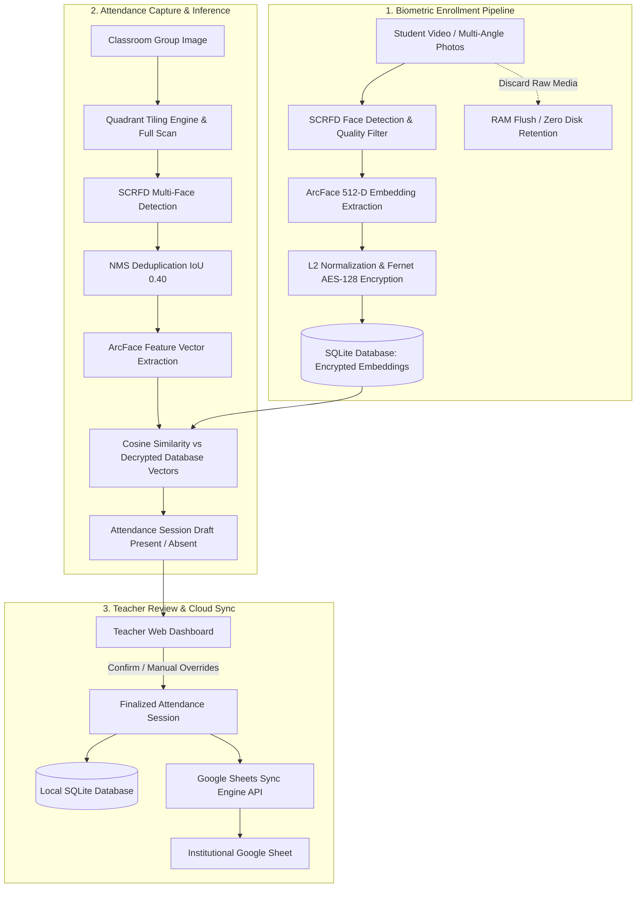

# Face Attendance Management System

An automated, privacy-first, biometric classroom attendance platform built with **Flask 3**, **InsightFace (SCRFD + ArcFace 512-D)**, **SQLite (WAL mode)**, **Fernet Biometric Encryption**, and **Google Sheets API**.

Designed for real-world educational institutions, the system solves the challenge of capturing attendance in large, high-density lecture halls from a single panoramic or wide-angle photograph—eliminating proxy attendance, manual roll calls, and identity fraud.

---

## 📑 Table of Contents
1. [🌟 Key Features](#-key-features)
2. [🏗️ System Architecture](#-system-architecture)
3. [🛠️ Technology Stack](#-technology-stack)
4. [📁 Repository Structure](#-repository-structure)
5. [🚀 Quick Start Guide](#-quick-start-guide)
6. [📊 Google Sheets Integration Guide (Dual Pathway)](#-google-sheets-integration-guide-dual-pathway)
   - [Method 1: Google Apps Script Webhook (Recommended)](#method-1-google-apps-script-webhook-recommended)
   - [Method 2: Google Cloud Service Account (gspread)](#method-2-google-cloud-service-account-gspread)
   - [API Specification & JSON Payloads](#api-specification--json-payloads)
   - [Core Business Logic & Non-Downgrade Safety](#core-business-logic--non-downgrade-safety)
7. [🐳 Docker Deployment](#-docker-deployment)
8. [🧪 Testing & Verification](#-testing--verification)
9. [🔒 Privacy & Compliance](#-privacy--compliance)
10. [❓ Troubleshooting FAQ](#-troubleshooting-faq)

---

## 🌟 Key Features

### 1. Robust Biometric Enrollment (Zero Raw Image Retention)
- **Multi-Angle Photo & Video Sampling**: Enrolls students using either 3–5 multi-angle photos or a 5-second video recording sampled at optimal frame intervals.
- **Biometric Quality Filters**: Analyzes image sharpness (Laplacian variance $>80$) and 3D head pose angles (yaw, pitch, roll) to reject blurred or heavily occluded samples.
- **Privacy by Design**: Raw face images and video files are processed strictly in ephemeral RAM and wiped immediately. Only 512-dimensional feature embeddings are retained.
- **Military-Grade Encryption**: Face feature vectors are serialized and encrypted using Fernet (AES-128-CBC + HMAC-SHA256) before storing in the database.

### 2. High-Density Classroom Recognition
- **Quadrant Tiling Engine**: Solves the small-face detection problem in high-resolution classroom images (4K / ultra-wide) by dividing the image into overlapping sub-regions alongside full-image scanning.
- **Non-Maximum Suppression (NMS)**: Merges overlapping detections across tiles using IoU thresholding ($IoU = 0.40$) to eliminate duplicate bounding boxes.
- **Sub-Second Matching**: Computes cosine similarity against enrolled student embeddings with a tuned threshold ($0.50$).

### 3. Teacher-in-the-Loop Review Workflow
- **Review Dashboard**: Automatically groups students into **Present** (high confidence) and **Absent** (unmatched).
- **Manual Status Override**: Teachers can inspect cropped face thumbnails, review detections, toggle attendance status, or add manual notes before finalizing.
- **Historical Records**: Full attendance session history with aggregated metrics (total enrolled, present count, attendance rate).

### 4. Automated Google Sheets Synchronization
- **Dual Cloud Sync Engine**: Supports zero-credential HTTP Webhook POST requests (via Google Apps Script) and standard Google Cloud OAuth2 Service Account authentication.
- **Dynamic Date Columns**: Detects existing dates or automatically generates new `DD-MM-YYYY` columns.
- **Non-Downgrade Safety Rule**: Prevents network retries or resubmissions from overwriting an existing **P** (Present) status with an **A** (Absent).

### 5. Security & Production Hardening
- **CSRF Protection**: Integrated across all state-changing endpoints with Flask-WTF.
- **Role-Based Access**: Session-based teacher authentication with Werkzeug password hashing.
- **Database Concurrency**: Configured SQLite with Write-Ahead Logging (WAL) and 30-second busy timeout to avoid locked database errors during external inspection.
- **Dockerized Ready**: Optimized multi-stage Docker build with OpenCV runtime libraries and Gunicorn WSGI.

---

## 🏗️ System Architecture



---

## 🛠️ Technology Stack

| Domain | Technology / Library | Purpose in this Project |
| :--- | :--- | :--- |
| **Backend Framework** | **Flask 3.x** | Core WSGI application handling routing, controllers, and blueprint architecture. |
| **Session & Auth Security** | **Flask-Login** | Secure session cookies, user loader, and protected route boundaries. |
| **Form Security & CSRF** | **Flask-WTF** & **WTForms** | Automatic CSRF token generation and validation on state-changing requests. |
| **Password Hashing** | **Werkzeug Security** | High-entropy password hashing (`scrypt` / `pbkdf2:sha256`). |
| **Database & ORM** | **SQLAlchemy** & **Flask-SQLAlchemy** | Relational models (`User`, `Student`, `FaceEmbedding`, `AttendanceSession`, `AttendanceRecord`). |
| **Database Engine** | **SQLite 3 (WAL Mode)** | Local transactional storage with Write-Ahead Logging and 30s timeout for concurrent access. |
| **Deep Learning Runtime** | **ONNX Runtime** | High-performance inference engine running neural network graphs on CPU. |
| **Face AI Models** | **InsightFace (`buffalo_l`)** | **SCRFD** (face detection & 5-point landmarks) and **ArcFace ResNet** (512-D embeddings). |
| **Computer Vision Core** | **OpenCV (`opencv-python`)** | Image decoding, quadrant tiling, and Laplacian variance blur analysis. |
| **Scientific Computing** | **NumPy** | High-speed vector math, L2 norm normalization, and cosine similarity dot products. |
| **Biometric Encryption** | **Cryptography (`Fernet`)** | Symmetric AES-128-CBC encryption + HMAC-SHA256 vector signing at rest. |
| **Cloud Synchronization** | **Google Apps Script Webhook** & **gspread** | Dual cloud sync engine supporting zero-credential Webhooks and GCP OAuth2 batch updates. |
| **Frontend UI** | **Jinja2, HTML5, CSS3** | Server-rendered responsive layouts, CSS Grid, status badges, mobile view. |
| **Containerization** | **Docker, Docker Compose, Gunicorn** | Multi-worker container deployment packaging OpenCV system dependencies. |

---

## 📁 Repository Structure

```text
face-attendance/
├── app/
│   ├── attendance/           # Attendance capture, session review, and history routes
│   │   ├── routes.py
│   │   └── __init__.py
│   ├── auth/                 # Teacher authentication & session handling
│   │   ├── routes.py
│   │   └── __init__.py
│   ├── face_engine/          # Computer vision and deep learning core
│   │   ├── classroom.py      # Quadrant tiling, NMS deduplication, group recognition
│   │   ├── engine.py         # SCRFD detection, ArcFace embeddings, Fernet encryption
│   │   └── __init__.py
│   ├── google_sheets/        # Google Sheets API synchronization client
│   │   ├── sync.py           # Auto-headers, batch cell updates, non-downgrade logic
│   │   └── __init__.py
│   ├── students/             # Student roster management & biometric enrollment
│   │   ├── routes.py
│   │   └── __init__.py
│   ├── templates/            # Jinja2 HTML responsive UI templates
│   ├── extensions.py         # Shared SQLAlchemy, LoginManager, CSRF instances
│   ├── models.py             # User, Student, FaceEmbedding, AttendanceSession models
│   └── __init__.py           # Application factory with SQLite WAL configuration
├── instance/                 # Local database storage (attendance.db)
├── models/                   # Local InsightFace model checkpoints (buffalo_l)
├── config.py                 # Central configuration loader with python-dotenv
├── run.py                    # Application entrypoint & CLI commands
├── run_all_tests.py          # Master test suite runner
├── Dockerfile                # Docker container definition
├── docker-compose.yml        # Docker service orchestration
├── USER_GUIDE.md             # Complete user and operations manual
└── requirements.txt          # Python dependencies
```

---

## 🚀 Quick Start Guide

### Prerequisites
- Python 3.10+ (Python 3.12 recommended)
- `ffmpeg` or system OpenCV dependencies (for Linux: `libgl1`, `libglib2.0-0`, `libgomp1`)
- Git

### 1. Clone & Set Up Virtual Environment

```bash
git clone https://github.com/Praveen-ASML24026/Face-Recognition-Attendance.git
cd Face-Recognition-Attendance

# Create virtual environment
python -m venv venv

# Activate virtual environment
# Windows:
.\venv\Scripts\activate
# Linux/macOS:
source venv/bin/activate

# Install dependencies
pip install -r requirements.txt
```

### 2. Configure Environment Variables

Create a `.env` file in the project root (refer to `.env.example`):

```ini
FLASK_APP=run.py
FLASK_ENV=development
SECRET_KEY=generate-a-strong-secret-key-here
ENCRYPTION_KEY=generate-fernet-key-here
DATABASE_URL=sqlite:///instance/attendance.db

# Option A: Google Apps Script Webhook (Zero GCP setup, recommended)
GOOGLE_SHEET_WEBHOOK_URL=https://script.google.com/macros/s/your_deployment_id/exec

# Option B: Traditional Google Cloud Service Account
GOOGLE_SERVICE_ACCOUNT_JSON=instance/service_account.json
GOOGLE_SHEET_ID=your-google-sheet-id-here
```

To generate a valid `ENCRYPTION_KEY`:
```bash
python -c "from cryptography.fernet import Fernet; print(Fernet.generate_key().decode())"
```

### 3. Initialize Teacher Account & Run Server

```bash
# Create initial admin/teacher credentials
flask --app run.py create-teacher

# Run the local development server
python run.py
```
Open [http://127.0.0.1:5000](http://127.0.0.1:5000) in your browser.

---

## 📊 Google Sheets Integration Guide (Dual Pathway)

The application supports two independent, production-tested pathways for synchronizing attendance sessions to Google Sheets:

| Feature | Method 1: Google Apps Script Webhook *(Recommended)* | Method 2: Google Cloud Service Account |
| :--- | :--- | :--- |
| **Complexity** | ⚡ **1 Minute (Easiest)** | ⏱️ 5–10 Minutes |
| **Cost** | 🆓 **100% Free** | 🆓 **100% Free** |
| **GCP / Console Setup** | ❌ None required | ✅ Required (Cloud Console) |
| **Org Policy Blocks** | 🛡️ **Immune** (Works on school/work accounts) | ⚠️ May be blocked by `iam.disableServiceAccountKeyCreation` |
| **Credential Files** | ❌ No `.json` file needed | ✅ Requires `service_account.json` |
| **Transport** | Direct HTTP POST | `gspread` + Google OAuth2 |

---

### Method 1: Google Apps Script Webhook (Recommended)

This method connects your Google Sheet directly through an HTTP Webhook deployed as a lightweight Google Apps Script Web App. It requires **zero Google Cloud Console configuration**, **zero credential keys**, and works on **all Google accounts** (personal, institutional, or corporate).

#### Step 1: Open Your Google Sheet & Apps Script
1. Open or create a Google Sheet at **[sheets.new](https://sheets.new)**.
2. In the top menu, click **Extensions** $\rightarrow$ **Apps Script**.
3. Delete any boilerplate code inside the editor.

#### Step 2: Paste the Webhook Handler Code
Copy and paste the following production script into the editor:

```javascript
function doPost(e) {
  try {
    var data = JSON.parse(e.postData.contents);
    var sheet = SpreadsheetApp.getActiveSpreadsheet().getActiveSheet();
    var dateStr = data.session_date; // Expected format: "DD-MM-YYYY"
    var attendance = data.attendance || {}; // e.g. {"STU001": "P", "STU002": "A"}
    var names = data.names || {}; // e.g. {"STU001": "Student Name"}

    var values = sheet.getDataRange().getValues();
    
    // 1. Initialize headers if sheet is empty
    if (values.length === 0 || values[0].length === 0 || values[0][0] === "") {
      sheet.appendRow(["Student ID", "Student Name", dateStr]);
      values = sheet.getDataRange().getValues();
    }

    var headers = values[0];
    var dateCol = headers.indexOf(dateStr) + 1; // 1-indexed

    // 2. Automatically create date column if missing
    if (dateCol === 0) {
      dateCol = headers.length + 1;
      sheet.getRange(1, dateCol).setValue(dateStr);
      headers.push(dateStr);
    }

    // 3. Map existing Student IDs to sheet rows
    var studentRowMap = {};
    for (var i = 1; i < values.length; i++) {
      if (values[i][0]) {
        studentRowMap[values[i][0].toString().trim()] = i + 1;
      }
    }

    // 4. Update or append student attendance records
    for (var studentId in attendance) {
      var status = attendance[studentId];
      var row = studentRowMap[studentId.toString().trim()];

      if (row) {
        var existingStatus = sheet.getRange(row, dateCol).getValue().toString().trim();
        // Mandatory Non-Downgrade Rule: Never overwrite 'P' with 'A'
        if (existingStatus !== "P") {
          sheet.getRange(row, dateCol).setValue(status);
        }
      } else {
        // New student not yet in sheet: append new row
        var studentName = names[studentId] || ("Student " + studentId);
        var newRow = [studentId, studentName];
        while (newRow.length < dateCol - 1) {
          newRow.push("");
        }
        newRow[dateCol - 1] = status;
        sheet.appendRow(newRow);
        studentRowMap[studentId] = sheet.getLastRow();
      }
    }

    return ContentService.createTextOutput(JSON.stringify({
      status: "success",
      message: "Attendance recorded successfully",
      date: dateStr,
      updated_count: Object.keys(attendance).length
    })).setMimeType(ContentService.MimeType.JSON);

  } catch (error) {
    return ContentService.createTextOutput(JSON.stringify({
      status: "error",
      message: error.toString()
    })).setMimeType(ContentService.MimeType.JSON);
  }
}
```

#### Step 3: Deploy as Web App
1. Click the blue **Deploy** button (top right) $\rightarrow$ select **New deployment**.
2. Click the gear icon ⚙️ next to "Select type" $\rightarrow$ choose **Web app**.
3. Set:
   - **Execute as**: `Me`
   - **Who has access**: `Anyone` *(Crucial so your server can POST data)*
4. Click **Deploy**.

#### Step 4: Authorize the Script
1. Click **Authorize access** and select your Google account.
2. When the *"Google hasn't verified this app"* warning appears:
   - Click the small link: **Advanced** (bottom left).
   - Click **Go to Untitled project (unsafe)**.
   - Click **Allow**.
3. Copy your **Web App URL** (e.g. `https://script.google.com/macros/s/.../exec`).

#### Step 5: Configure `.env`
Add the URL to your project's `.env` file:
```ini
GOOGLE_SHEET_WEBHOOK_URL=https://script.google.com/macros/s/your_deployment_id/exec
```

---

### Method 2: Google Cloud Service Account (`gspread`)

If your deployment mandates traditional IAM service accounts, follow this setup:

#### Step 1: Create a Google Cloud Project
1. Navigate to **[Google Cloud Console](https://console.cloud.google.com/)**.
2. Click **New Project** $\rightarrow$ Name it `Attendance-Sync` $\rightarrow$ Click **Create**.

#### Step 2: Enable Required APIs
Enable the following free APIs:
- **[Google Sheets API](https://console.cloud.google.com/apis/library/sheets.googleapis.com)**
- **[Google Drive API](https://console.cloud.google.com/apis/library/drive.googleapis.com)**

#### Step 3: Create Service Account & Export Key
1. Go to **APIs & Services** $\rightarrow$ **Credentials**.
2. Click **+ CREATE CREDENTIALS** $\rightarrow$ **Service account**.
3. Name it `attendance-sync` $\rightarrow$ Click **Done**.
4. Click on the newly created service account email.
5. Go to the **KEYS** tab $\rightarrow$ **ADD KEY** $\rightarrow$ **Create new key** $\rightarrow$ Choose **JSON** $\rightarrow$ **Create**.
6. Move the downloaded key file into your project:
   ```text
   instance/service_account.json
   ```

> [!TIP]
> If Google blocks key creation with `iam.disableServiceAccountKeyCreation`, either switch to **Method 1 (Apps Script)** or run this in Google Cloud Shell:
> ```bash
> gcloud resource-manager org-policies disable-enforce iam.disableServiceAccountKeyCreation --project=YOUR_PROJECT_ID
> ```

#### Step 4: Share Your Google Sheet
1. Open your Google Sheet $\rightarrow$ click the green **Share** button.
2. Paste the service account's email address (e.g., `attendance-sync@your-project.iam.gserviceaccount.com`).
3. Set role to **Editor**, uncheck "Notify people", and click **Share**.
4. Copy the **Sheet ID** from the URL:
   `https://docs.google.com/spreadsheets/d/`**`<SHEET_ID>`**`/edit`.

#### Step 5: Configure `.env`
```ini
GOOGLE_SERVICE_ACCOUNT_JSON=instance/service_account.json
GOOGLE_SHEET_ID=your_extracted_sheet_id_here
```

---

### API Specification & JSON Payloads

The sync engine dispatches a structured JSON payload to the Google Sheet backend upon teacher confirmation:

#### HTTP Request
- **Method**: `POST`
- **Content-Type**: `application/json`

#### JSON Request Schema
```json
{
  "session_date": "06-11-2026",
  "attendance": {
    "ASML24001": "P",
    "ASML24002": "A",
    "ASML24003": "P"
  },
  "names": {
    "ASML24001": "Praveen R",
    "ASML24002": "Alice Smith",
    "ASML24003": "Bob Jones"
  }
}
```

#### JSON Response Schema
```json
{
  "status": "success",
  "message": "Attendance recorded successfully",
  "date": "06-11-2026",
  "updated_count": 3
}
```

---

### Core Business Logic & Non-Downgrade Safety

1. **Automatic Column Provisioning**:
   - The engine checks for a column named after the current `DD-MM-YYYY` date.
   - If missing, it automatically creates the header column on the right without disturbing previous records.

2. **Mandatory Non-Downgrade Rule**:
   - If a student is already marked **`P`** (Present) on a given date, subsequent resubmissions or re-scans will **never downgrade them to `A`** (Absent).
   - Upgrading from **`A`** to **`P`** upon re-scan or manual correction is permitted.

3. **Dynamic Student Enrollment**:
   - If an enrolled student does not yet exist in the Google Sheet roster, a new row is appended with their `Student ID` and `Student Name`.

---

## 🐳 Docker Deployment

Run the complete application in a self-contained container:

```bash
# Build and run with Docker Compose
docker-compose up --build -d

# View container logs
docker-compose logs -f
```
The application will be accessible at [http://localhost:5000](http://localhost:5000).

---

## 🧪 Testing & Verification

The project includes an end-to-end master test suite verifying all 8 operational phases:

```bash
python run_all_tests.py
```

### Verification Coverage:
1. **Phase 1: Foundation & Auth** — User models, password hashing, student directory CRUD.
2. **Phase 2: Face Engine** — SCRFD face detection, ArcFace 512-D vectors, cosine similarity, sharpness/pose evaluation.
3. **Phase 3: Biometric Enrollment** — Photo/video sampling, Fernet encryption integrity, zero image leakage.
4. **Phase 4: Classroom Tiling** — High-resolution quadrant tiling, IoU overlap calculation, NMS deduplication.
5. **Phase 5 & 6: Attendance Workflow** — Review interface, manual override state persistence, session history.
6. **Phase 7: Google Sheets API** — Header formatting, non-downgrade logic, batch updates.
7. **Phase 8: Security** — CSRF verification, unauthorized route protection, ciphertext encryption guarantees.

To test the Google Sheets synchronization engine specifically:
```bash
python test_google_sheets_sync.py
```

---

## 🔒 Privacy & Compliance

- **No Raw Biometric Storage**: Student face photos and videos are processed exclusively in volatile memory and destroyed once embeddings are extracted.
- **Encrypted Feature Vectors**: Mathematical face representations are stored as AES-128 encrypted blobs.
- **Audit Logging**: Every attendance session logs the teacher identity, timestamp, detection confidence scores, and manual review history.

---

## ❓ Troubleshooting FAQ

### 1. Error: `Google hasn't verified this app` during Webhook setup
- **Cause**: Google displays this warning for self-authored Apps Scripts.
- **Solution**: Click **Advanced** $\rightarrow$ Click **Go to Untitled project (unsafe)** $\rightarrow$ Click **Allow**.

### 2. Error: `HTTP 405 Method Not Allowed`
- **Cause**: You opened the Webhook URL in a regular browser tab (which sends a `GET` request instead of a `POST` request).
- **Solution**: The script defines `doPost(e)`. Test it using Python `requests.post()` or via the web application.

### 3. Status shows `Saved Locally (Sheets unconfigured)`
- **Cause**: The `.env` file does not contain a valid `GOOGLE_SHEET_WEBHOOK_URL` or `GOOGLE_SERVICE_ACCOUNT_JSON`.
- **Solution**: Check that your `.env` contains:
  ```ini
  GOOGLE_SHEET_WEBHOOK_URL=https://script.google.com/macros/s/.../exec
  ```
  Restart your Flask server after modifying `.env`.

### 4. Updates appear in sheet, but an existing 'P' turned to 'A'
- The Apps Script and `sync.py` enforce the non-downgrade rule. Verify that the `doPost` code contains:
  ```javascript
  if (existingStatus !== "P") {
    sheet.getRange(row, dateCol).setValue(status);
  }
  ```
