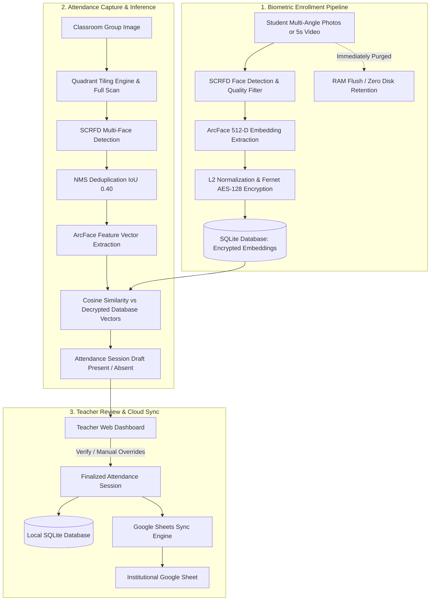

# Face Attendance Management System — Complete User & Operations Guide

An end-to-end operational and technical manual for teachers, administrators, and developers using the **Face Attendance Management System**.

---

## 📑 Table of Contents
1. [👩‍🏫 Non-Technical Teacher Cheatsheet (Daily 30-Second Routine)](#-non-technical-teacher-cheatsheet-daily-30-second-routine)
2. [What is this Project? (Project Explanation)](#-what-is-this-project-project-explanation)
3. [Complete Technology Stack](#-complete-technology-stack)
4. [System Architecture & Processing Pipeline](#-system-architecture--processing-pipeline)
5. [Quick Start: Launching the Application](#-quick-start-launching-the-application)
6. [Teacher Account Management](#-teacher-account-management)
7. [Step 1: Student Directory Registration](#-step-1-student-directory-registration)
8. [Step 2: Biometric Enrollment (Photos & Video)](#-step-2-biometric-enrollment-photos--video)
9. [Step 3: Taking Classroom Attendance](#-step-3-taking-classroom-attendance)
10. [Step 4: Teacher Review & Manual Adjustments](#-step-4-teacher-review--manual-adjustments)
11. [Step 5: Google Sheets Cloud Synchronization](#-step-5-google-sheets-cloud-synchronization)
12. [Viewing Attendance History & Audit Logs](#-viewing-attendance-history--audit-logs)
13. [Photography Guidelines for Maximum Accuracy](#-photography-guidelines-for-maximum-accuracy)
14. [Plain-English Glossary & FAQ for Non-Tech Users](#-plain-english-glossary--faq-for-non-tech-users)

---

## 👩‍🏫 Non-Technical Teacher Cheatsheet (Daily 30-Second Routine)

> [!TIP]
> **Are you a teacher, professor, or school administrator with zero coding background?**  
> You do **not** need to understand Python, AI math, or terminal commands to use this daily. Just follow these 4 simple steps:

```
┌────────────────────────────────────────────────────────────────────────┐
│               YOUR DAILY 4-STEP ATTENDANCE ROUTINE                     │
├────────────────────────────────────────────────────────────────────────┤
│ 1. LOG IN           👉 Open http://127.0.0.1:5000 and enter your name  │
│ 2. SNAP & UPLOAD    👉 Click "Take Attendance" & upload 1–2 photos     │
│ 3. GLANCE & REVIEW  👉 Green = Present, Red = Absent (Click to toggle) │
│ 4. CLICK CONFIRM    👉 Done! Your Google Sheet updates automatically   │
└────────────────────────────────────────────────────────────────────────┘
```

### Detailed 4-Step Breakdown:

#### 1. Open the Website & Log In
- On your phone or laptop, open your browser and go to the attendance link provided by your IT department (e.g., `http://127.0.0.1:5000/login`).
- Type your teacher username and password and click **Log In**.

#### 2. Snap & Upload Classroom Photos
- Click **Take Attendance** in the top navigation bar.
- Stand near the front podium and snap **1 or 2 wide photos** of your students sitting at their desks.
- Click **Choose File** $\rightarrow$ select the photo(s) from your phone or laptop $\rightarrow$ click the blue **Analyze Classroom & Recognize Faces** button.

#### 3. Glance at the Review Screen
- In 5–10 seconds, the AI will display the student list:
  - 🟢 **Green Badge (Present)**: The AI recognized this student.
  - 🔴 **Red Badge (Absent)**: The student was not seen.
- **Did the camera miss someone?** (e.g. someone sitting behind a tall student or wearing a winter hood):
  - Just click the **Mark Present** button next to their name.

#### 4. Click "Confirm & Finalize Attendance"
- Click the big blue button at the bottom: **Confirm & Finalize Attendance**.
- **You're finished!** That class is recorded, and your Google Sheet spreadsheet is instantly updated with today's date and Present/Absent marks.

---

---

## 💡 What is this Project? (Project Explanation)

### The Problem It Solves
In educational institutions and training centers, conventional attendance methods suffer from fundamental flaws:
- **Time Wastage**: Calling out 60–100 names takes 10 to 15 minutes of every lecture hour.
- **Proxy Attendance**: Students sign paper sheets, scan RFID cards, or punch biometric fingerprints on behalf of absent peers.
- **Distant & Small Face Failures**: Standard facial recognition systems only work when individuals stand 1 foot away from a single webcam. They completely fail when trying to detect dozens of small, distant student faces sitting across a 50-foot lecture hall.
- **Biometric Privacy Risks**: Storing raw photographs of students creates significant regulatory and legal liabilities (GDPR, FERPA) in the event of a database breach.

### How this System Works
The **Face Attendance Management System** allows a teacher to take complete classroom attendance in **under 30 seconds** from a single panoramic or wide-angle photograph taken on their smartphone:

1. **Quadrant Tiling & Small Face Detection**:
   - High-resolution classroom images (up to 4K) are scanned both at full scale and divided into overlapping quadrant tiles.
   - Each tile is processed by the state-of-the-art **SCRFD (Sample and Computation Redistribution for Efficient Face Detection)** deep neural network, allowing it to detect small faces even in the furthest back rows.
   - **Non-Maximum Suppression (NMS)** with an Intersection-over-Union ($IoU = 0.40$) threshold automatically eliminates duplicate bounding boxes caused by overlapping tiles.

2. **ArcFace 512-Dimensional Deep Biometric Matching**:
   - Each detected face is normalized and passed through the **ArcFace (Additive Angular Margin Loss)** model to extract a 512-dimensional mathematical feature vector.
   - The engine computes **cosine similarity** against enrolled student vectors at a tuned threshold ($0.50$) to verify student identities in sub-second time.

3. **Zero-Knowledge Privacy by Design**:
   - Student face photos and videos are **never permanently stored on disk**. They are decoded temporarily in volatile RAM, processed to extract mathematical vectors, and the raw media is immediately purged.
   - Extracted vectors are serialized and encrypted using **Fernet (AES-128-CBC + HMAC-SHA256)** at rest. Even if the database is stolen, no face photos or raw biometric vectors can ever be recovered.

4. **Human-in-the-Loop Verification**:
   - The teacher is presented with a clear visual dashboard grouping students into **Present** and **Absent**, along with cropped thumbnails of any unrecognized faces.
   - Teachers can override any status with a single click before submission.

5. **Automated Cloud Synchronization**:
   - Verified attendance records automatically synchronize with institutional **Google Sheets** in real time, automatically creating date columns and strictly enforcing the **Non-Downgrade Safety Rule** (an existing Present mark is never overwritten by an Absent mark).

---

## 🛠️ Complete Technology Stack

The application is built entirely with production-grade, open-source libraries across 7 distinct engineering domains:

| Category | Technology / Library | Purpose in this Project |
| :--- | :--- | :--- |
| **Backend Web Framework** | **Flask 3.x** | Core WSGI application handling routing, controllers, and application factory pattern. |
| **Session & Auth Security** | **Flask-Login** | Secure cookie session management, user loader, and `@login_required` route guards. |
| **Form & CSRF Security** | **Flask-WTF** & **WTForms** | Automatic CSRF token generation and validation on all state-changing `POST` endpoints. |
| **Password Hashing** | **Werkzeug Security** | Secure password hashing (`scrypt` / `pbkdf2:sha256`) for teacher authentication. |
| **Database & ORM** | **SQLAlchemy** & **Flask-SQLAlchemy** | Relational data modeling for `User`, `Student`, `FaceEmbedding`, `AttendanceSession`, and `AttendanceRecord`. |
| **Database Engine** | **SQLite 3 (WAL Mode)** | Local transactional storage configured with Write-Ahead Logging (WAL) and 30s busy timeout for high-concurrency read/write operations without locking. |
| **Deep Learning Runtime** | **ONNX Runtime** | High-performance inference engine running neural network graphs on CPU. |
| **Face Detection & Embeddings** | **InsightFace (`buffalo_l`)** | Includes **SCRFD** (face detection & 5-point landmark localization) and **ArcFace ResNet** (512-D normalized biometric feature extraction). |
| **Computer Vision Core** | **OpenCV (`opencv-python-headless`)** | Video frame decoding, multi-scale image resizing, quadrant tiling, and Laplacian variance blur estimation. |
| **Scientific Computing** | **NumPy** | High-speed vector math, L2 norm normalization, and cosine similarity matrix dot products. |
| **Biometric Encryption** | **Cryptography (`Fernet`)** | Symmetric AES-128-CBC encryption and HMAC-SHA256 signing for all stored biometric vectors at rest. |
| **Cloud Synchronization** | **Google Apps Script Webhook** & **gspread** | Dual cloud sync engine supporting zero-credential HTTP Webhook POST requests and Google OAuth2 service account batch updates. |
| **Frontend UI & Templates** | **Jinja2, HTML5, CSS3** | Server-side rendered responsive dashboard with CSS grid, status badges, and mobile-friendly layouts. |
| **Containerization & WSGI** | **Docker**, **Docker Compose**, **Gunicorn** | Multi-worker containerized deployment packaging system OpenCV libraries (`libgl1`, `libglib2.0-0`, `libgomp1`). |

---

## 🏗️ System Architecture & Processing Pipeline



---

## 🚀 Quick Start: Launching the Application

### 1. Start the Server
Open PowerShell in the project directory:

```powershell
# Navigate to the project root
cd C:\Projects\FCP-teamup\face-attendance

# Activate the virtual environment
.\venv\Scripts\activate

# Start the Flask application
python run.py
```

### 2. Access the Web Dashboard
Open your web browser and navigate to:
👉 **[http://127.0.0.1:5000](http://127.0.0.1:5000)**

---

## 🔑 Teacher Account Management

All student and attendance records require an authenticated teacher or administrator session.

### Option A: Create Teacher via Terminal CLI (Recommended for Initial Setup)
Run this command from your terminal:

```powershell
flask --app run.py create-teacher
```
You will be prompted to enter:
1. **Teacher Username** (e.g., `prof_smith` or `praveen`)
2. **Password** (minimum 12 characters recommended for security)
3. **Password Confirmation**

### Option B: Self-Registration via Web Interface
1. Go to [http://127.0.0.1:5000/register](http://127.0.0.1:5000/register).
2. Enter your desired username and password.
3. Upon registration, log in at [http://127.0.0.1:5000/login](http://127.0.0.1:5000/login).

---

## 🎓 Step 1: Student Directory Registration

Before biometric data can be collected, the student must be added to the institutional directory:

1. Click on **Students** in the top navigation bar (or visit [http://127.0.0.1:5000/students/](http://127.0.0.1:5000/students/)).
2. Click the **+ Enroll Student** button.
3. Fill in the student's institutional details:
   - **Full Name**: e.g., `Praveen R S`
   - **Student ID**: e.g., `ASML24026` *(Must be unique across the institution)*
4. Click **Register & Continue to Biometrics**.
5. The student is created with an initial status of **Pending Biometrics**.

---

## 📸 Step 2: Biometric Enrollment (Photos & Video)

Once registered, you will be automatically directed to the **Biometric Enrollment** page.

### 1. Mandatory Informed Consent
Check the box:  
☑️ *"I confirm that the student has provided informed consent for facial biometric feature extraction."*

### 2. Upload Biometric Samples (Choose One or Both Methods):

#### Method A: Multi-Angle Photographs (Recommended)
Upload clear, well-lit photos of the student's face:
- **Front-Facing** *(Mandatory if not uploading video)*: Looking straight into the camera.
- **Left Profile**: Head turned ~30° to the left.
- **Right Profile**: Head turned ~30° to the right.
- **Looking Up**: Chin tilted slightly upward (~15°).
- **Looking Down**: Chin tilted slightly downward (~15°).

#### Method B: Short 5-Second Video Clip
- Upload an `.mp4`, `.mov`, or `.webm` video where the student slowly turns their head from left to right.
- The engine will automatically sample optimal keyframes and extract multi-pose embeddings.

### 3. Click "Extract & Encrypt Biometrics"
- The **SCRFD detector** identifies the face and measures image sharpness (Laplacian variance $>80$).
- The **ArcFace model** extracts 512-dimensional facial feature vectors.
- The vectors are encrypted with **Fernet AES-128** and saved to the database.
- **All uploaded image and video files are immediately destroyed from disk.**
- The student's badge updates to **Enrolled (Active)**.

---

## 🏫 Step 3: Taking Classroom Attendance

When conducting a class in a lecture hall or classroom:

1. In the top navigation bar, click **Take Attendance** (or go to [http://127.0.0.1:5000/attendance/upload](http://127.0.0.1:5000/attendance/upload)).
2. Configure session parameters:
   - **Session Date**: Today's date is selected by default; change it if logging for a previous session.
   - **Confidence Threshold**: Default is **`0.50`** (optimal balance between strict accuracy and angle tolerance). Lower to `0.45` for distant/dim classrooms, or raise to `0.55` for high-security verification.
3. Upload **1 to 3 Classroom Photographs**:
   - For wide lecture halls, upload 2–3 overlapping photos (e.g., Left Wing, Center, Right Wing).
4. Click **Analyze Classroom & Recognize Faces**.
5. The system divides each photo into high-resolution overlapping tiles, detects all faces, eliminates duplicates using **Non-Maximum Suppression (NMS)**, and matches each face against your enrolled students.

---

## 🔍 Step 4: Teacher Review & Manual Adjustments

Once recognition completes, the **Interactive Review Dashboard** opens:

### 1. Summary Metrics
At the top of the review screen, you will see:
- **Total Faces Detected in Room**: e.g., `42`
- **Recognized Students**: e.g., `38`
- **Unknown Faces**: e.g., `4` *(visitors, auditors, or students whose faces were partially occluded)*

### 2. Student Attendance Table
Every registered student in your directory is listed:
- **Present (Green Badge)**: Identified by ArcFace with the matching confidence score (e.g., `Confidence: 0.78`).
- **Absent (Red Badge)**: Unmatched students.

### 3. Manual Overrides (Human-in-the-Loop)
If a student was sitting behind a pillar or arrived late:
- Click the **Mark Present** or **Mark Absent** button next to their name.
- The status updates immediately in real time, and the record is flagged as `Manually Verified`.

### 4. Unknown Faces Gallery
- Review cropped thumbnails of faces detected in the room that did not meet the recognition threshold.
- If an unknown crop belongs to an absent student (e.g. wearing a mask or glasses), simply click **Mark Present** next to their name in the table.

---

## ☁️ Step 5: Google Sheets Cloud Synchronization

Once you have verified the attendance list:

1. Click the blue **Confirm & Finalize Attendance** button at the bottom of the review page.
2. The system executes two actions simultaneously:
   - Saves the confirmed attendance session permanently into your local SQLite database.
   - Dispatches a batch update directly to your connected **Google Sheet**.
3. A success notification will appear:
   ```text
   Attendance session confirmed! Synced 40 students to Google Sheets for 06-11-2026 (38 Present).
   ```
4. Open your Google Sheet—the date column (e.g., `06-11-2026`) is populated with **`P`** and **`A`** marks!

> [!IMPORTANT]
> **The Non-Downgrade Safety Rule**: If you rescan a class or submit attendance twice on the same day, the system will **never overwrite an existing 'P' with an 'A'**. Only attendance upgrades are permitted.

---

## 📊 Viewing Attendance History & Audit Logs

1. Click **History** in the top navigation bar ([http://127.0.0.1:5000/attendance/history](http://127.0.0.1:5000/attendance/history)).
2. Browse historical attendance sessions:
   - **Session Date**
   - **Verified By** (Teacher Name)
   - **Total Enrolled vs. Present Count**
   - **Attendance Percentage**
   - **Cloud Sync Status**: `Synced` or `Pending`
3. Click **Inspect Session** to view individual student confidence scores and audit whether any marks were manually edited.

---

## 📷 Photography Guidelines for Maximum Accuracy

To achieve $\ge 95\%$ first-pass recognition accuracy in large classrooms:

| Recommendation | Why It Matters |
| :--- | :--- |
| **Use Landscape Mode** | Captures wider rows and avoids excessive floor/ceiling areas. |
| **Take 2–3 Sector Photos** | Rather than trying to cram 80 students into one panoramic shot, take one photo of the left side, center, and right side. |
| **Hold Camera at Chest/Eye Height** | Standing on the teacher's podium or platform gives a clear line of sight over students' heads. |
| **Adequate Room Lighting** | Turn on room fluorescent/LED lights; avoid strong backlighting from open windows behind students. |
| **Stable Capture (No Motion Blur)** | Ensure the camera is held steady or mounted on a phone tripod to prevent blurry faces. |

---

## ❓ Plain-English Glossary & FAQ for Non-Tech Users

### Plain-English Glossary (Zero Technical Jargon)

| Term You See in App | What It Means in Simple English |
| :--- | :--- |
| **"Confidence Score"** (e.g. `0.78`) | How sure the AI is that this face belongs to the student. `1.0` is a 100% exact twin match; anything above `0.50` is considered a confirmed match. |
| **"Confidence Threshold"** (`0.50`) | The sensitivity dial. **Leave it at `0.50` by default.** If the classroom is dark or students sit very far, lower it to `0.45` to catch more faces. If you want ultra-strict verification, raise it to `0.55`. |
| **"Unknown Faces"** | People the camera saw who are not registered in the system (e.g. guest lecturers, auditors, or students whose faces were partially hidden). |
| **"Informed Consent"** | The legal checkbox confirming the student agreed to register their face in the school system. |
| **"Non-Downgrade Rule"** | A safety rule: If you accidentally take attendance twice on the same day, the system will **never** change someone who was marked "Present" into "Absent". |
| **"Google Sheet Webhook"** | The automated bridge that copies your confirmed attendance into your school's Google Sheet in real time. |

---

### Everyday Questions for Teachers & Staff

#### 1. Do I need to be a programmer or know terminal commands to use this daily?
**No, absolutely not.** Starting the server is only done once by IT/admin. As a teacher or staff member, you interact solely with a clean, visual web interface on your phone or laptop just like using Gmail or Google Classroom.

#### 2. What if an enrolled student gets a new haircut, puts on glasses, or grows a beard?
- Go to the **Students** menu $\rightarrow$ click **Edit / Re-enroll** next to their name.
- Upload 1 or 2 new photos or a quick 5-second video.
- The new look is added to their face profile immediately without deleting their past attendance records!

#### 3. What if a student was sitting behind a pillar and the camera missed them?
- On the Review screen, just click the green **Mark Present** button next to their name before clicking Confirm. You always have full human control.

#### 4. Can students mark their own attendance or cheat the system?
- **No.** The website requires your teacher login. Students cannot access the camera upload or review page.
- Also, because the teacher snaps the live classroom photo in person, students who are not physically in their seats cannot be marked present.

#### 5. What if the school's Wi-Fi goes down while taking attendance?
- Everything saves safely in the local system database on your device.
- You can review and confirm attendance normally. Once your Wi-Fi is back on, open **History** and click Confirm to push the attendance records to your Google Sheet!

#### 6. Are student photos stored anywhere where hackers could steal them?
- **No.** All photos and videos uploaded during registration or class are automatically wiped from memory as soon as the facial math is extracted. No photos exist on the hard drive.

