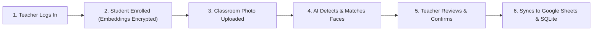

# Face Attendance Management System — Complete User & Operations Guide

An end-to-end operational manual for teachers, administrators, and operators using the **Face Attendance Management System**.

---

## 📑 Table of Contents
1. [System Overview & Architecture](#-system-overview--architecture)
2. [Quick Start: Launching the Application](#-quick-start-launching-the-application)
3. [Teacher Account Management](#-teacher-account-management)
4. [Step 1: Student Registration](#-step-1-student-registration)
5. [Step 2: Biometric Enrollment (Photos & Video)](#-step-2-biometric-enrollment-photos--video)
6. [Step 3: Taking Classroom Attendance](#-step-3-taking-classroom-attendance)
7. [Step 4: Teacher Review & Manual Adjustments](#-step-4-teacher-review--manual-adjustments)
8. [Step 5: Google Sheets Cloud Synchronization](#-step-5-google-sheets-cloud-synchronization)
9. [Viewing Attendance History & Audit Logs](#-viewing-attendance-history--audit-logs)
10. [Photography Guidelines for Maximum Accuracy](#-photography-guidelines-for-maximum-accuracy)
11. [Troubleshooting & Common Questions](#-troubleshooting--common-questions)

---

## 🌟 System Overview & Architecture

The **Face Attendance Management System** replaces paper attendance sheets and manual roll calls with an automated, deep-learning-powered biometric platform.



### Key Technical Guarantees:
- **Privacy-by-Design**: Raw photos and videos of students are **never saved** to disk. They are held in volatile RAM only long enough to extract mathematical features, and then immediately purged.
- **Biometric Encryption**: Extracted 512-dimensional face vectors are encrypted with **Fernet (AES-128-CBC + HMAC-SHA256)** at rest.
- **Small-Face Recognition**: A high-resolution **quadrant tiling engine** detects students seated in the back rows of large lecture halls.

---

## 🚀 Quick Start: Launching the Application

### 1. Start the Server
Open PowerShell in the project directory:

```powershell
# Navigate to the project root
cd C:\Projects\FCP-teamup\face-attendance

# Activate the virtual environment
.\venv\Scripts\activate

# Start the Flask application
python run.py
```

### 2. Access the Web Dashboard
Open your web browser and navigate to:
👉 **[http://127.0.0.1:5000](http://127.0.0.1:5000)**

---

## 🔑 Teacher Account Management

All student and attendance records require an authenticated teacher or administrator session.

### Option A: Create Teacher via Terminal CLI (Recommended for Initial Setup)
Run this command from your terminal:

```powershell
flask --app run.py create-teacher
```
You will be prompted to enter:
1. **Teacher Username** (e.g., `prof_smith` or `praveen`)
2. **Password** (minimum 12 characters recommended for security)
3. **Password Confirmation**

### Option B: Self-Registration via Web Interface
1. Go to [http://127.0.0.1:5000/register](http://127.0.0.1:5000/register).
2. Enter your desired username and password.
3. Upon registration, log in at [http://127.0.0.1:5000/login](http://127.0.0.1:5000/login).

---

## 🎓 Step 1: Student Registration

Before biometric data can be collected, the student must be added to the institutional directory:

1. Click on **Students** in the top navigation bar (or visit [http://127.0.0.1:5000/students/](http://127.0.0.1:5000/students/)).
2. Click the **+ Enroll Student** button.
3. Fill in the student's institutional details:
   - **Full Name**: e.g., `Praveen R S`
   - **Student ID**: e.g., `ASML24026` *(Must be unique across the institution)*
4. Click **Register & Continue to Biometrics**.
5. The student is created with an initial status of **Pending Biometrics**.

---

## 📸 Step 2: Biometric Enrollment (Photos & Video)

Once registered, you will be automatically directed to the **Biometric Enrollment** page.

### 1. Mandatory Informed Consent
Check the box:  
☑️ *"I confirm that the student has provided informed consent for facial biometric feature extraction."*

### 2. Upload Biometric Samples (Choose One or Both Methods):

#### Method A: Multi-Angle Photographs (Recommended)
Upload clear, well-lit photos of the student's face:
- **Front-Facing** *(Mandatory if not uploading video)*: Looking straight into the camera.
- **Left Profile**: Head turned ~30° to the left.
- **Right Profile**: Head turned ~30° to the right.
- **Looking Up**: Chin tilted slightly upward (~15°).
- **Looking Down**: Chin tilted slightly downward (~15°).

#### Method B: Short 5-Second Video Clip
- Upload an `.mp4`, `.mov`, or `.webm` video where the student slowly turns their head from left to right.
- The engine will automatically sample optimal keyframes and extract multi-pose embeddings.

### 3. Click "Extract & Encrypt Biometrics"
- The **SCRFD detector** identifies the face and measures image sharpness (Laplacian variance $>80$).
- The **ArcFace model** extracts 512-dimensional facial feature vectors.
- The vectors are encrypted with **Fernet AES-128** and saved to the database.
- **All uploaded image and video files are immediately destroyed from disk.**
- The student's badge updates to **Enrolled (Active)**.

---

## 🏫 Step 3: Taking Classroom Attendance

When conducting a class in a lecture hall or classroom:

1. In the top navigation bar, click **Take Attendance** (or go to [http://127.0.0.1:5000/attendance/upload](http://127.0.0.1:5000/attendance/upload)).
2. Configure session parameters:
   - **Session Date**: Today's date is selected by default; change it if logging for a previous session.
   - **Confidence Threshold**: Default is **`0.50`** (optimal balance between strict accuracy and angle tolerance). Lower to `0.45` for distant/dim classrooms, or raise to `0.55` for high-security verification.
3. Upload **1 to 3 Classroom Photographs**:
   - For wide lecture halls, upload 2–3 overlapping photos (e.g., Left Wing, Center, Right Wing).
4. Click **Analyze Classroom & Recognize Faces**.
5. The system divides each photo into high-resolution overlapping tiles, detects all faces, eliminates duplicates using **Non-Maximum Suppression (NMS)**, and matches each face against your enrolled students.

---

## 🔍 Step 4: Teacher Review & Manual Adjustments

Once recognition completes, the **Interactive Review Dashboard** opens:

### 1. Summary Metrics
At the top of the review screen, you will see:
- **Total Faces Detected in Room**: e.g., `42`
- **Recognized Students**: e.g., `38`
- **Unknown Faces**: e.g., `4` *(visitors, auditors, or students whose faces were partially occluded)*

### 2. Student Attendance Table
Every registered student in your directory is listed:
- **Present (Green Badge)**: Identified by ArcFace with the matching confidence score (e.g., `Confidence: 0.78`).
- **Absent (Red Badge)**: Unmatched students.

### 3. Manual Overrides (Human-in-the-Loop)
If a student was sitting behind a pillar or arrived late:
- Click the **Mark Present** or **Mark Absent** button next to their name.
- The status updates immediately in real time, and the record is flagged as `Manually Verified`.

### 4. Unknown Faces Gallery
- Review cropped thumbnails of faces detected in the room that did not meet the recognition threshold.
- If an unknown crop belongs to an absent student (e.g. wearing a mask or glasses), simply click **Mark Present** next to their name in the table.

---

## ☁️ Step 5: Google Sheets Cloud Synchronization

Once you have verified the attendance list:

1. Click the blue **Confirm & Finalize Attendance** button at the bottom of the review page.
2. The system executes two actions simultaneously:
   - Saves the confirmed attendance session permanently into your local SQLite database.
   - Dispatches a batch update directly to your connected **Google Sheet**.
3. A success notification will appear:
   ```text
   Attendance session confirmed! Synced 40 students to Google Sheets for 06-11-2026 (38 Present).
   ```
4. Open your Google Sheet—the date column (e.g., `06-11-2026`) is populated with **`P`** and **`A`** marks!

> [!IMPORTANT]
> **The Non-Downgrade Safety Rule**: If you rescan a class or submit attendance twice on the same day, the system will **never overwrite an existing 'P' with an 'A'**. Only attendance upgrades are permitted.

---

## 📊 Viewing Attendance History & Audit Logs

1. Click **History** in the top navigation bar ([http://127.0.0.1:5000/attendance/history](http://127.0.0.1:5000/attendance/history)).
2. Browse historical attendance sessions:
   - **Session Date**
   - **Verified By** (Teacher Name)
   - **Total Enrolled vs. Present Count**
   - **Attendance Percentage**
   - **Cloud Sync Status**: `Synced` or `Pending`
3. Click **Inspect Session** to view individual student confidence scores and audit whether any marks were manually edited.

---

## 📷 Photography Guidelines for Maximum Accuracy

To achieve $\ge 95\%$ first-pass recognition accuracy in large classrooms:

| Recommendation | Why It Matters |
| :--- | :--- |
| **Use Landscape Mode** | Captures wider rows and avoids excessive floor/ceiling areas. |
| **Take 2–3 Sector Photos** | Rather than trying to cram 80 students into one panoramic shot, take one photo of the left side, center, and right side. |
| **Hold Camera at Chest/Eye Height** | Standing on the teacher's podium or platform gives a clear line of sight over students' heads. |
| **Adequate Room Lighting** | Turn on room fluorescent/LED lights; avoid strong backlighting from open windows behind students. |
| **Stable Capture (No Motion Blur)** | Ensure the camera is held steady or mounted on a phone tripod to prevent blurry faces. |

---

## ❓ Troubleshooting & Common Questions

### 1. What happens if an enrolled student gets a haircut, glasses, or beard?
- Go to **Students** $\rightarrow$ Click **Edit / Re-enroll** next to their name.
- Upload new photos or a quick 5-second video.
- The new biometric vectors will be added to their encrypted profile without deleting their historical attendance logs.

### 2. What if a student is marked absent even though they were present?
- In the Review screen, simply click **Mark Present** before clicking "Confirm Attendance".
- You can also raise or lower the match threshold on the upload screen (e.g., try `0.45` for distant classrooms).

### 3. How do I change the Google Sheet where attendance is saved?
- Open your [`.env`](file:///c:/Projects/FCP-teamup/face-attendance/.env) file.
- Update `GOOGLE_SHEET_WEBHOOK_URL` with your new Webhook URL (see [`GOOGLE_SHEETS_GUIDE.md`](file:///c:/Projects/FCP-teamup/face-attendance/GOOGLE_SHEETS_GUIDE.md)).
- Restart the Flask server.

### 4. Can students mark their own attendance?
- **No.** The system requires teacher login credentials to access the camera upload, review, and Google Sheets submission endpoints. Students cannot access these URLs without logging in.

### 5. What if the internet goes down during class?
- The application stores all attendance sessions and encrypted biometrics in the local SQLite database ([`instance/attendance.db`](file:///c:/Projects/FCP-teamup/face-attendance/instance/)).
- You can take attendance completely offline. When internet connectivity is restored, re-opening the session in **History** and clicking confirm will sync the backlog to Google Sheets.
